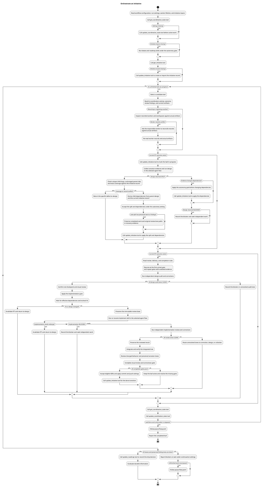

# Orchestrate an initiative

The [workflow terms](../workflow/SKILL.md#common-terms) define the shared lifecycle.
The diagrams own phase order, branches, and returns.
The prose defines inputs, constraints, and tool arguments.

## Core flow

The following PlantUML block defines the required orchestration process.
The [pause flow](references/pause-flow.puml) applies when unfinished work must pause.

## Inputs and coordination contracts

Required inputs are:
- `.prism/workflow.md`
- the roadmap initiative
- intent
- Approved requirements
- the initiative record
- linked evidence when they exist.
The [run settings](references/run-settings.md) define decision gates and agent flow.
The [worker lifetime](references/worker-lifetime.md) rules define valid worker waits, resumes, and replacements.
The `get_coordination_state` input includes the initiative path, even when `state.json` does not exist.
The `update_coordination_state` input includes the current revision.
Settings resolution supplies `changes.settings`.
Initiative state updates supply current workers, blockers, next actions, and evidence paths.
Missing records establish neither approval nor completion.
The agent flow is immutable after active work starts.
Dependent work requires its applicable gate under the resolved autonomy setting.

## Design and worker invariants

The design worker receives ancestor diagram and ADR paths, including inherited paths.
Design can start before prerequisite implementation when available evidence supports it.
The initiative record supplies each slice's title, outcome, and requirement assignment, and an existing `slice.md` supplies the design narrative.
The configured `agentFlow` controls design and implementation routing.
In `multi` flow, the `Develop <slice>` worker receives requirements, the initiative identifier, workspace, settings, and ancestor paths.
The `Develop <slice>` worker remains available after `FIT` for implementation and corrections.
The [initiative record](references/initiative-record.md) defines the slice graph rules and the `update_initiative` operations.
When no initiative record exists, `update_initiative` receives `expectedRevision: null` and a `create` operation with the root slug, title, outcome, and complete Approved requirement assignment.
When a legacy `map.puml` exists without an initiative record, `update_initiative` receives an `import_map` operation with its path instead of `create`.
An accepted split reaches `update_initiative` as one `split` operation with each child's slug, title, outcome, and requirements, followed by any `set_dependencies` operations.
Leaf status changes reach `update_initiative` as `set_status` operations with `in-progress` or `done`.
The server refuses a `done` status until the slice's completion gate passes.
The `update_roadmap` ship operation receives the initiative identifier and is refused until every leaf slice is done.
`get_roadmap` derives the initiative's `planned` and `in-progress` states, so orchestration writes no roadmap state for them.
A missing roadmap entry for the initiative is a missing initiative input, so its roadmap entry exists before the initiative record is created.
A roadmap entry or priority change made during orchestration waits for user acceptance through a recorded `decision` gate unless `full` autonomy resolves roadmap priority.
Graduation moves facts that later work needs from the initiative directory into durable sources under the [artifact rules](../workflow/references/artifact-rules.md).
After the ship decision and graduation, coordination cleanup deletes the initiative directory, and the roadmap keeps the shipped record.

A valid `SPLIT` has unique child slugs, an unchanged parent title, and exact collective requirement coverage.
Child dependencies follow the parent design and the initiative record, and require acceptance under the autonomy setting.
An accepted split parent never executes again.
Its completion waits for all descendants and preserved findings.
Late splits preserve completed work and original review lane paths in recovery evidence.
A split result is persisted only when a later worker needs a fact that no existing artifact owns.

## Delivery invariants

Delivery requires a current `FIT` result.
The [review and correction rules](references/review-rules.md) apply to design audits and implementation reviews.
The [delivery rules](references/delivery-rules.md) define implementation constraints.
The [integration and completion rules](references/completion-rules.md) define integration and completion constraints.

## User gate records

The orchestrator records each user gate before asking the user and resolves it after the answer.
Every question to the user goes through a recorded gate, and related questions share one gate.
The `update_coordination_state` input includes `changes.gateOperations` with one `ask` operation that supplies the gate kind, the slice slug when one applies, the question, and the project-relative artifact paths to inspect.
Gate kinds are `visual-review` for design and final visual review, `correctness` for correctness confirmation, `decision` for requirement, decision, conflict, split, and dependency questions, and `assistance` for user actions such as a separate review task.
A `decision` gate supplies `options` when its choices are known, so the user can pick one in the review browser.
The user answers either in the conversation or in the review browser, which records the answer on the pending gate.
After asking the user, the orchestrator calls `wait_for_user_gate` once with the ids of every gate it just recorded when the tool is available, so browser answers return as the tool result and resume the run.
An `answered` wait result holds the user's answers to the listed gates, and gates it reports as still waiting get a new wait after the answers are acted on.
A `resolved`, `timeout`, `unknown_gate`, or `unsupported_host` wait result, or an aborted wait, ends the turn, and the user's next message delivers the answer.
A wait result for a gate that the orchestrator already resolved needs no action.
After a wait times out, is aborted, or returns `unsupported_host`, later gates in the same session skip the wait.
A recorded browser answer is the user's answer to that question.
Before asking again, resuming, or continuing after a user message, read the pending gates and act on every recorded answer.
An answered gate is never asked again.
After acting on the answer, or when the question is withdrawn, a `resolve` operation receives the gate id that the `ask` result returned.
A gate that the autonomy setting settles automatically is not recorded.
The review browser lists recorded gates as waiting on the user.

## State and recovery invariants

The initiative's `state.json` records current coordination facts beside `initiative.json`.
Typed `activeOperations` use `start`, `update`, `finish`, and `release`; only `finish` claims completion after the server checks current review evidence.
Activities are `design`, `implementation`, `review`, and `integration`, with descriptive labels stored separately.
The initiative record alone owns slice topology, titles, outcomes, requirement assignments, dependencies, and status.
The orchestrator is the only workflow writer for initiative state.
Mono delivery records `orchestrator` as the active worker and the current workspace.
State evidence paths resolve from the note's directory unless absolute.
Empty lists mean no current item.
An old recovery note for an inactive parent slice is historical evidence, not an active pause failure.

The `checkpoint_pause` input includes the current revision, active slice, recovery content and path, and state changes.
The fallback `update_coordination_state` input includes the current revision, recovery path, and state changes.
The fallback applies only when `checkpoint_pause` is unavailable and the other coordination-state tools work.
A completed pause requires recovery and state updates.
Replacement workers need retained recovery and ancestor evidence after compaction or handoff.
Older coordination files remain until their required information has a durable home.
Conversation-only facts belong in the owning slice folder only when a later worker needs them.
The [delegation procedure](../workflow/references/delegation.md) governs child-worker delegation.

- Don't
  - Create user-owned tasks as child-agent substitutes.
