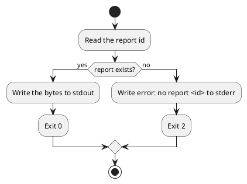

# Activity view

An `activity` view answers which steps and decisions one operation takes, when no other party matters to the question.

- Write each step as an action `:…;` and each decision as `if (…) then (…)`.
- Open with `start` and close each path with `stop` or `end`.
- Name each branch by the condition a clause states.

