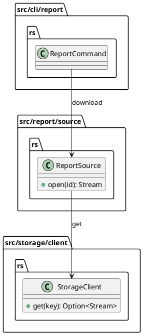

# Code view

A `code` view answers which units the slice changes and how they depend on each other.
Write one only when the gate reader's question is about code structure that no clause states, such as a unit that two slices share; it is never required.

- Draw each unit that **Changes** names as a `class`, grouped by its file in a `package`.
- Name only the members whose interface changes.
- Point each relation from the unit that calls to the unit it calls.

