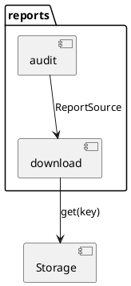

# Component view

A `component` view answers which parts exist and which interfaces connect them.
The overview of a plan of several slices is a `component` view named `overview.puml` that names each slice by its slug, the interfaces the slices share, and their order.

- Draw each part as a `component`, grouped in a `package` when parts belong together.
- Label each relation with the interface or call that crosses it.
- Point each relation from the part that depends to the part it depends on.

