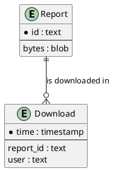

# Data model view

A `data-model` view answers which records exist, which fields identify them, and how many of one belong to another.

- Draw each record as an `entity` with a body, its key fields above `--`.
- Draw each relation with crow's-foot ends, such as `||--o{`, labelled by what links the records.
- Show only the fields that a clause names.

