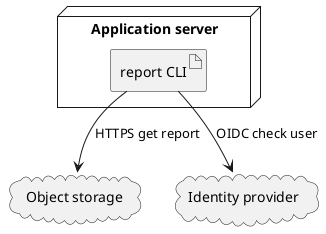

# Deployment view

A `deployment` view answers where each part runs and what crosses between machines.

- Draw each machine or runtime as a `node` and each hosted service you do not run as a `cloud`.
- Put each deployed `artifact` inside the node that runs it.
- Label each relation with the protocol or call that crosses the network.

