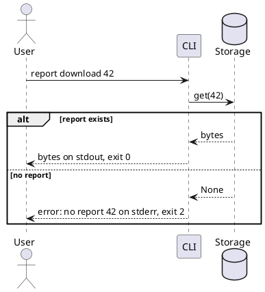

# Sequence view

A `sequence` view answers who calls whom, in what order, and what returns on each path a clause names.

- Declare each participant once, as `actor`, `participant`, or `database`, in the order a reader meets them.
- Label each message with the call or text the contract fixes.
- Show each alternative path of a clause in an `alt` or `opt` block closed by `end`.

