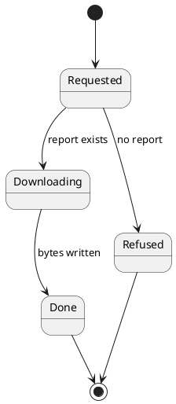

# State view

A `state` view answers which states a record moves through and which event moves it.

- Start from `[*]` and end each final state at `[*]`.
- Label each transition with the command or event that a clause names.
- Draw each state that a caller can observe, and no internal step.

