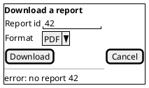

# Write a wireframe view

A `wireframe` [view](../workflow/SKILL.md#common-terms) shows what a user sees on one screen or dialog that the contract changes, and the contract decides where the two differ.
Declare it in the **Views** section of its folder's `slice.md` as [write-diagram](../write-diagram/SKILL.md#2-declare-the-view) shows, with kind `wireframe`.

1. Write PlantUML Salt starting with `@startsalt` and ending with `@endsalt`.
2. Lay the screen out as grids `{ … }` whose cells are separated by `|`, and use `.` for an empty cell.
3. Write each control the contract names with its exact label, such as `[Download]` for a button, `"42   "` for a text field, `()` or `[X]` for a choice, and `^Format^` for a list.
4. Show each state a clause names, such as an error, as its own text in the screen or as its own wireframe.
5. Keep a wireframe at 60 widgets or fewer, the non-empty cells of its grids, and split a larger screen into views of its regions.

- Don't
  - Write `salt` inside `@startuml`, which Prism refuses.
  - Style the wireframe with colors or fonts, because it shows layout and labels, not visual design.
  - Render the view or look at a rendered image.
